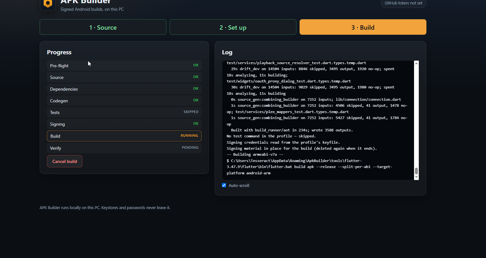
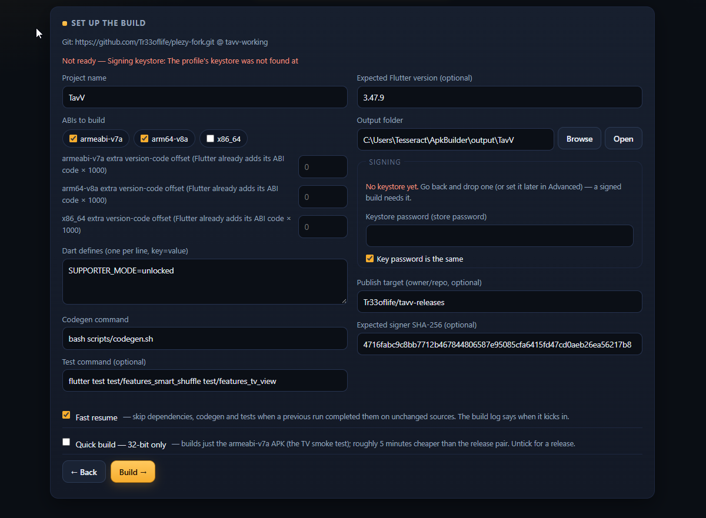
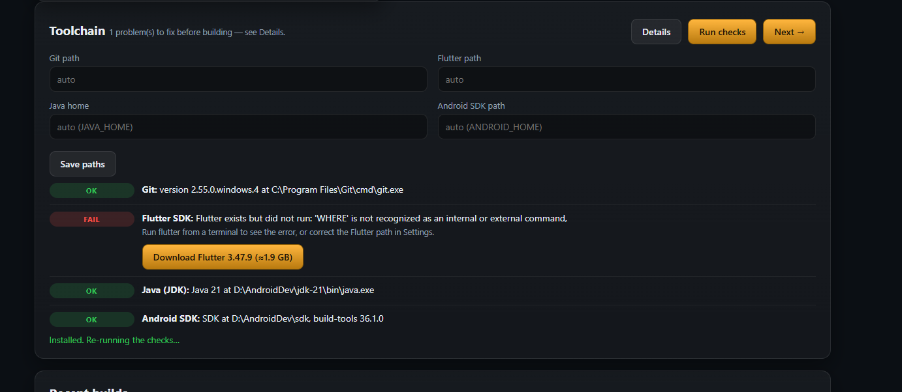
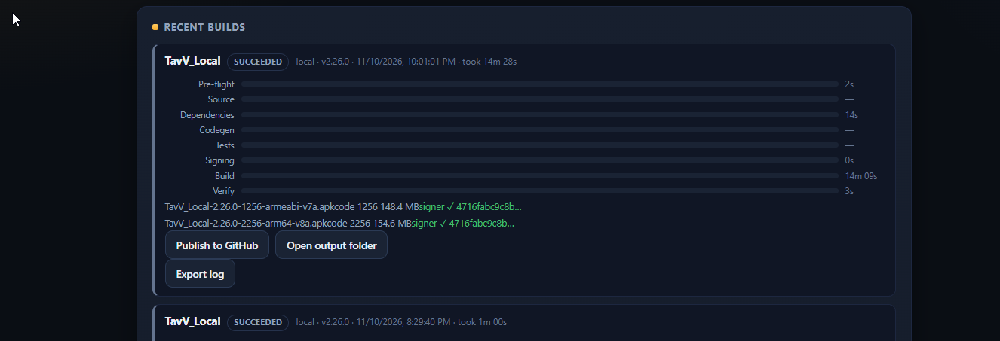

# APK Builder

**Signed Android builds, on this PC.**

APK Builder is a small Windows program that builds apps on your own machine — no cloud build minutes, no uploads, nothing metered. Flutter and Gradle projects become signed Android APKs; Go projects become Windows programs; Flutter projects can also build as Windows bundles. Your source, your keystore and your passwords never leave the PC. The app only touches the network when you ask it to: GitHub sign-in, publishing, update checks, and tool downloads.

**Runs on:** Windows 10/11 · **Builds:** Android APKs · Windows programs

📥 **[Download the latest release](https://github.com/Tr33oflife/apk-builder-releases/releases/latest)** · [All releases](https://github.com/Tr33oflife/apk-builder-releases/releases)

*A build running. Eight stages — pre-flight, source, dependencies, codegen, tests, signing, build, verify — with the live log beside them.*

---

## What you need

- A **Windows PC**.
- The toolchains your project uses — Git, a JDK, the Android SDK, Flutter. The built-in health checklist tests each one and can download what's missing.
- For signed release APKs, **your keystore**. The app reads it locally at build time; passwords are typed per build and never stored.
- Optionally, a **GitHub account** — for publishing releases and for watched build drops.

## What it does

### Four build routes

- **Flutter → Android APK** — split per ABI (armeabi-v7a, arm64-v8a, x86_64), with dart defines, codegen and test commands from the profile.
- **Gradle → Android APK** — the project's own Gradle build, using its pinned wrapper.
- **Go → Windows program** — a single version-stamped `.exe`, cross-compiled from Go source.
- **Flutter → Windows bundle** — the Release folder, zipped, ready to run.

### Pick a source, set it up, build

Three steps. Drop a project folder or a zip onto the app, give it a Git address, or connect GitHub and pick the repo from a list. Everything about a project — branch, ABIs, signing, output folder, publish target — is saved as a **profile**, so the next build of the same app is two clicks. A plain-language ready line on the setup screen tells you what's still missing before you press Build.

*Setting up a build. The red line at the top is the ready check doing its job — it names what's missing instead of letting the build fail later.*

### Sign in to GitHub — no token pasting

The **Connect GitHub** button signs you in through your browser (a short code, approved on github.com). The token is kept in the Windows Credential Manager and is used for the repo picker and for publishing.

### Signing stays home, and the result is checked

Signing material is read on this PC, at build time, and removed again when the build ends. The Verify stage then checks the finished APK's signer fingerprint against the expected SHA-256 and reads back its version — a build that signed with the wrong key fails loudly instead of shipping quietly.

### Built for long, heavy builds

- A **warm working tree** per project, so repeat builds skip the clone-and-fetch churn.
- **Fast resume** — unchanged sources skip dependencies, codegen and tests.
- **Quick build** — a 32-bit-only APK for a fast smoke test.
- A **build queue**, and an automatic one-ABI-at-a-time retry if the compiler runs out of memory.

### When something fails, it says why

The toolchain health checklist (in Settings) tests Git, Flutter, Java and the Android SDK and offers the fix for whatever fails — including downloading the missing piece. Build failures come with plain-language guides matched to the error, not just a raw log.

*The health checklist catching a broken Flutter install — and offering the download that fixes it.*

### After the build

Publish straight to a GitHub releases repo (the app reads the release back afterwards to prove the upload landed), install the APK on a TV over ADB, open the output folder, or export the log. Every finished build lands in Recent builds with its per-step timings and its artifacts listed.

*Recent builds. Per-step timings, the artifacts, the signer check — and Publish, right on the card.*

### Watched build drops

Point a **watch** at a repository and this PC becomes its builder: push an `apk_builder.yaml` manifest — or a release tag, depending on the watch — and the app queues the build, parks it if it needs a signing password, and posts the receipt back as a GitHub commit status when it's done.

### Processes

One room lists every running build, the tool processes it spawned, and other long-running programs — including which ones have gone quiet and are probably wedged — with a force-stop for the stuck ones.

### Housekeeping

Backup and restore for profiles and settings, a Clean up room for caches and old outputs, a disk-space line that warns before a build runs the drive dry — and **in-app updates**: the app checks this repo and offers new versions itself.

---

## Downloads

Grab the newest build from the **[Releases page](https://github.com/Tr33oflife/apk-builder-releases/releases)**. Each release carries:

| File | For |
|---|---|
| `apk-builder-v<version>-windows.zip` | Windows 10/11 — unzip anywhere and run `ApkBuilder.exe` |
| `version.json` | The update manifest the app checks — you don't need this by hand |

The app is unsigned, so Windows will warn on the first run: **More info → Run anyway**. After that, updates arrive inside the app.

---

## Changelog

Full notes live on each [release](https://github.com/Tr33oflife/apk-builder-releases/releases); the headlines:

### v0.9.9 — Hotfix: the keystore dialog's buttons work again

- In v0.9.7/v0.9.8 the Generate-a-keystore dialog opened but its buttons were dead — its markup sat after the app's script tag, so the startup wiring never reached it. Moved, and the order is now guarded by a test.

### v0.9.8 — Password generators

- Generate buttons beside the keystore dialog's password fields: strong 20-character passwords, look-alikes removed, shown in plain text so they can be saved.

### v0.9.7 — Generate a keystore

- No keystore yet? **Generate one on this PC** from Step 2 or the Profiles editor — keytool makes the keystore, a matching key.properties comes with it, the signing fields are filled in, and the new certificate's SHA-256 fingerprint is shown (and offered as the expected signer).

### v0.9.6 — GitHub sign-in

- **Connect GitHub** (device sign-in in the browser) replaces pasting a personal access token; the token lives in the Windows Credential Manager either way.

### v0.9.0 — Windows builds

- New route: **Flutter → Windows bundle**, alongside the Android routes.
- Publishing now attaches APKs and the Windows bundle to the same release when both were built for a version.

### v0.8.0 — Processes room

- See every running build, its tool children, and wedged processes — and stop the stuck ones.

### v0.7.0 — Watched build drops

- Git watches: a pushed manifest or tag becomes a build on this PC, with receipts posted back to GitHub.
